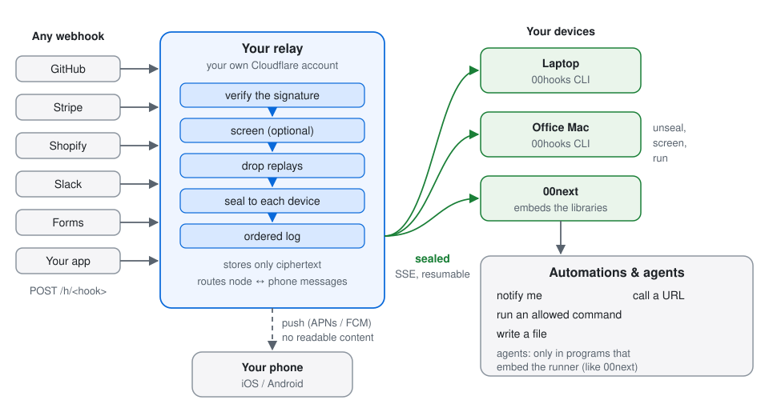
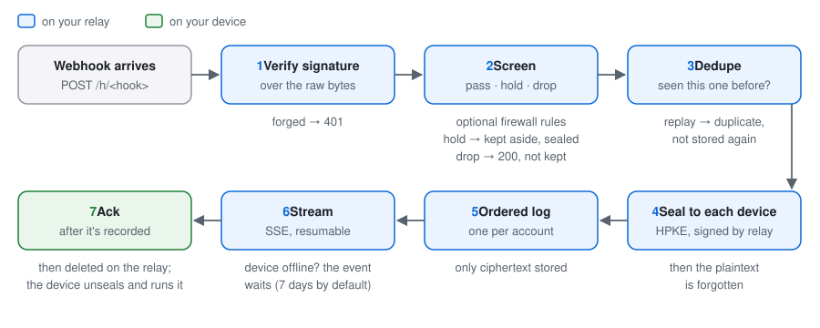
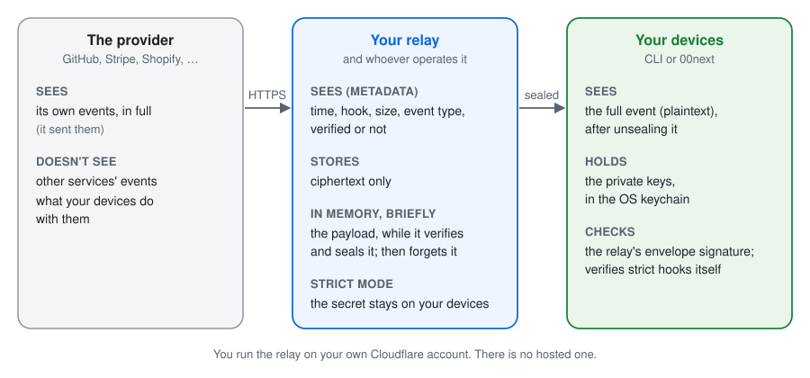

# 00hooks

**Webhooks from anywhere, delivered to your own computer: verified, sealed, in order, and safe to
act on.**

Point GitHub, Stripe, Shopify, Slack, Calendly or your own app at a hook URL. A small relay that
**you** run on **your own Cloudflare account** checks the provider's signature, drops replays,
seals the event so only your devices can open it, and streams it to the `00hooks` CLI on your Mac
or Linux machine (or to [00next](#works-with-00next), which embeds the same libraries). There it
runs your automations: notify you, call a URL, run an allowed command, write a file.

You don't open a port, run a public server or trust a third party with the payloads. Nobody hosts
this for you: you deploy it, in one command.

<p align="center">
  
</p>

## What makes it different

- **Your machine, no inbound port.** Your computer connects out to the relay and keeps a resumable
  stream open. Nothing listens on your machine.
- **Sealed end to end, to your devices.** After verifying an event, the relay seals it with HPKE to
  each of your devices' keys and signs the envelope. Its storage holds only ciphertext, so whoever
  operates the relay can't read your events at rest. (It does see the payload in memory while it
  checks the signature; **strict** hooks keep even the provider's secret off the relay.)
- **Genuine events only.** 18 provider presets check signatures over the raw bytes, with timestamp
  windows where the provider signs one, in constant time. Forgeries get `401` and are never stored.
- **Replays refused, twice.** The relay keeps replay marks for each hook. Your runner also dedupes
  by event id, and by content for providers that sign no timestamp.
- **A firewall in front of your automations.** The screen passes, holds or drops each event: rules
  on address, network, country, headers, size, fields and time of day, similarity to what you
  dropped before, and an optional AI evaluator that can only answer typed questions.
- **Nothing lost when your laptop sleeps.** An ordered log per account, with acknowledgements and
  resume. Events wait (7 days by default) and run once, in order, when you're back.
- **Cheap while idle.** The relay's object talks to your stream over a hibernating WebSocket, so an
  idle connection costs close to nothing beyond the Workers plan. You can measure it on your own
  account ([`relay/docs/IDLE-COST.md`](relay/docs/IDLE-COST.md)).
- **Webhook content is data.** It is never put into a shell command, a file path or an agent's
  instructions. Commands get argument lists, never a shell.
- **Phones too.** The relay carries a sealed link between your computer and your phone, and can
  wake an iPhone (APNs) or an Android phone (FCM) with a push that carries no readable content.

<p align="center">
  
</p>

## Install on your Cloudflare account

You need a Cloudflare account on the Workers Paid plan, Node 22+, pnpm, and this repository.

```sh
pnpm install                                   # once, at the repository root
pnpm --filter ./relay exec wrangler login      # your own Cloudflare login
node relay/scripts/setup.mjs --dry-run         # see every step first; nothing is run
pnpm --filter ./relay setup                    # install
```

The installer creates the D1 database, writes a gitignored deploy config with your own ids,
applies the migrations, **generates every secret the relay needs on your computer** and hands each
to `wrangler secret put` on stdin (never as an argument, a file or a log line), optionally asks for
your APNs and Firebase keys (hidden input, validated), deploys, and checks the result. It prints
your relay URL and the signup token, once, with the exact command to pair. Run it again any time:
it picks up where it stopped and never replaces a secret unless you confirm. Afterwards,
`node relay/scripts/setup.mjs --check-only` (or `00hooks relay status`) checks the relay.

There is no "Deploy to Cloudflare" button, on purpose: it couldn't give your account its own
rate-limit ids or keep secret generation on your machine. The details, and the manual steps, are in
[`relay/README.md`](relay/README.md).

## Pair the CLI

You need a Rust toolchain (`rustup`; `rust-toolchain.toml` picks the stable channel).

```sh
cargo install --locked --path cli/00hooks       # the `00hooks` binary, into ~/.cargo/bin
read -rs HOOKS_SIGNUP_TOKEN && export HOOKS_SIGNUP_TOKEN   # paste the token the installer showed
00hooks login --relay https://<your relay>; unset HOOKS_SIGNUP_TOKEN
00hooks relay status                            # version, protocol, keys, clock, push
```

Login creates this computer's signing and sealing keys in the OS keychain and pins the relay's
key. To add another computer, run `00hooks devices add` on one you already have and use the code
it prints with `00hooks login` on the new one.

### Works with 00next

00next embeds the same client and runner libraries. Give it the same relay URL and signup token
and it pairs like any other device; its agents get events as quoted, untrusted data, within the
limits you set there.

## A first hook, in a minute

```sh
00hooks hooks create --name ci --preset github  # prints the URL and, once, the secret
# paste both into GitHub: Settings > Webhooks > Add webhook (content type: application/json)
00hooks test ci                                 # the relay signs a sample with the hook's own secret
00hooks listen                                  # watch events arrive (or --json)
```

Then write `~/.config/00hooks/automations.yaml`:

```yaml
version: 1
automations:
  - name: Tell me about new issues
    when: { hook: ci, kinds: [issues] }
    only_if: payload.action == "opened"
    then:
      - notify: "#{{payload.issue.number}} {{payload.issue.title | truncate:60}}"
```

and run it: `00hooks run` (or `00hooks service install` to start it at login).

A few more things a hook can do:

```
00hooks hooks deliver-to ci "office mac"        only that computer gets the hook's events (runs once)
00hooks devices tag "office mac" office-macs    label a computer
00hooks hooks deliver-to ci --tag office-macs   every computer with that tag (add devices, repeat --tag)
00hooks hooks deliver-to ci --all               every computer again
00hooks hooks response ci --status 200 --content-type application/json --body '{"ok":true}'
00hooks devices rename <device> "office mac"    a clearer name
00hooks hooks create --name pay --preset stripe --strict --secret-stdin
                                                verify here: the relay never holds Stripe's secret
00hooks keys create --name ci --scope hooks:read   an API key for CI (it can never read events)
00hooks audit                                   what changed, and who changed it
```

## Provider presets

| Preset | How it is checked | Strength |
|---|---|---|
| `standard-webhooks` (Svix, Resend, Clerk…) | HMAC over id, timestamp and body, 5-minute window | strong |
| `standard-webhooks-ed25519` | Ed25519: the relay holds only the sender's public key | strongest |
| `stripe` | `Stripe-Signature`, 5-minute window | strong |
| `slack` | `v0` HMAC with timestamp; `url_verification` answered | strong |
| `linear` | HMAC, signed timestamp within 60 s | strong |
| `calendly` | `t=…,v1=…` HMAC, 3-minute window | strong |
| `paddle` | `ts=…;h1=…` HMAC, 5-second window | strong |
| `twitch` | EventSub HMAC with timestamp; the challenge answered | strong |
| `github` | `X-Hub-Signature-256` over the body | medium: no timestamp, replay marks instead |
| `shopify` | `X-Shopify-Hmac-Sha256` over the body | medium |
| `meta` (WhatsApp, Messenger, Instagram) | `X-Hub-Signature-256`; the GET verify-token check answered | medium |
| `twilio` | HMAC-SHA1 over the URL and parameters; TwiML answers | medium |
| `typeform` | `Typeform-Signature` over the body | medium |
| `pagerduty` | `X-PagerDuty-Signature` over the body | medium |
| `zoom` | `v0` HMAC; `endpoint.url_validation` answered | medium |
| `hmac` | your choice of header, algorithm and encoding | strong if the sender supports it |
| `token` | a secret header, constant-time compare | medium: no body integrity |
| `unverified` | anything | marked unverified; automations refuse it unless you allow it |

[`docs/PROTOCOL.md`](docs/PROTOCOL.md) §3 says exactly what each preset signs and dedupes on.

## The security model, in plain words

<p align="center">
  
</p>

- **The relay verifies, it never acts.** Everything that does something happens on your machine,
  under rules you set there.
- **What the relay sees:** when an event arrived, which hook, its size, the provider's event type
  and whether it verified. It stores the content only as ciphertext sealed to your devices.
- **What it can't do:** read stored events, sign as your devices, or turn a stolen API key into a
  reader of your events (streaming needs a device key that never leaves the machine).
- **What a compromised relay could still do:** see payloads in memory as it seals them, and
  withhold or delay events (you'd see the gaps). With a strict hook it can't forge, downgrade or
  replay that hook's events either.
- **Requests are signed** by device keys, with single-use nonces. Hook secrets are stored encrypted,
  shown once, and rotate with an overlap.

The full model is [`docs/PLAN.md`](docs/PLAN.md) §4; the wire contract is
[`docs/PROTOCOL.md`](docs/PROTOCOL.md). Found a problem? See [`SECURITY.md`](SECURITY.md).

## Automations

`00hooks run` listens and runs the automations in `~/.config/00hooks/automations.yaml` (or
`--automations <file>`, or `HOOKS_AUTOMATIONS`); `00hooks service install` runs it at login.

```yaml
version: 1
notify: system                # or `none`: notifications are only recorded
hooks:
  payments: { structure_only: true }   # the catalogue keeps no sample or values for this hook
automations:
  - name: New issues
    when: { hook: github, kinds: [issues] }   # or `kinds: any`, `new_kind: true`, `shape_changed: true`
    only_if: payload.action == "opened" and payload.repository.full_name in ["acme/web"]
    verified_only: true       # the default
    rate_limit: 30/hour       # the default; repeated failures pause it (pause_after: 5, pause_for: 15m)
    allow_hosts: [api.example.com]
    allow_commands: [/usr/bin/say]
    then:
      - notify: "#{{payload.issue.number}} {{payload.issue.title | truncate:60}}"
      - call:
          url: https://api.example.com/issues/{{payload.issue.number}}
          headers: { Authorization: "Bearer {{secret.API_TOKEN}}" }   # `00hooks secrets set API_TOKEN`
          body: { title: "{{payload.issue.title}}" }
      - run: { command: say, args: ["New issue {{payload.issue.number}}"], timeout: 10s }
      - write: { append: ~/hooks/issues.jsonl }
```

- **Filters** compare fields (`payload.…`, `headers.…`, `event.…`) with `==`, `!=`, `>`, `<`, `>=`,
  `<=`, `in`, `contains`, `matches` (a literal regular expression) and combine them with `and`,
  `or`, `not`. They can't run anything.
- **Templates** fill `{{path}}` slots, with the filters `money`, `truncate`, `json` and `upper`.
- **Actions** never use a shell: a command gets an argument list and the event on stdin (or in a
  file named by `HOOKS_EVENT_FILE`), with only `PATH`, `HOME` and `LANG` from your environment, in a
  private working folder of its own that is removed afterwards; a call's host must be in
  `allow_hosts`; a file's folder is fixed and its name sanitised.
- **Option injection**: an argument that begins with an event value (`"{{payload.url}}"`) and
  renders to something starting with `-` would be read by many programs as an option
  (`git --upload-pack=…`, `ssh -oProxyCommand=…`), so the run is refused. Arguments you write,
  `--title={{payload.title}}` included, are never refused. Two keys on the `run` action change it:

  ```yaml
  - run: { command: git, args: [clone, "{{payload.url}}"], options_end: "--" }  # `--` goes before the first event-led argument
  - run: { command: tool, args: ["{{payload.x}}"], raw: true }                  # pass values starting with `-` as they are
  ```

  Use `options_end` for programs that honour `--` (arguments after it may start with `-`), and
  `raw: true` only for a program those values can't mislead.
- **Batches** (optional): instead of running once per event, an automation can hold its events in
  a file and run once for all of them, when things go quiet or after a set time at most:

  ```yaml
  - name: Sensor readings
    when: { hook: sensors, kinds: any }
    batch:
      idle: 2m          # run once no new event has come for 2 minutes
      max_wait: 10m     # ...or 10 minutes after the batch's first event, even if events keep coming
      max_events: 500   # ...or once 500 are held (default 1000)
    allow_commands: [/usr/local/bin/process-readings]
    then:
      - run: { command: process-readings }   # gets every held event
  ```

  Give `idle`, `max_wait` or both (each from 5s to 24h; `max_wait` at least `idle`). Whichever
  comes first runs the batch; a batch also runs early once it holds 8 MiB. Filters,
  `verified_only` and the screen still look at each event before it joins. When the batch runs,
  a command gets every event as JSON lines on stdin and in the file named by `HOOKS_EVENTS_FILE`
  (`HOOKS_EVENT_FILE` is the last one), plus `HOOKS_BATCH_ID`, `HOOKS_BATCH_COUNT`,
  `HOOKS_BATCH_FIRST`, `HOOKS_BATCH_LAST` and `HOOKS_BATCH_REASON` (`idle`, `max_wait`,
  `max_events`, `max_bytes` or `flush`). Templates read `{{batch.count}}`, `{{batch.first}}`,
  `{{batch.last}}`, `{{batch.reason}}` and `{{events | json}}` (`payload` is the last event's);
  `write: { append: … }` adds a line per event; a `call` sends the events as a JSON array.
  The held events are kept on disk in the runner's private folder, so a restart loses none: the
  timers carry on from the first event, and a batch that came due meanwhile runs at once. The rate
  limit and the pause after failures count batch runs. While an automation is paused or over its
  limit, its batch waits and keeps holding events up to its limit; past that, new events aren't
  held and are counted, each with a note in `00hooks runs` (`00hooks replay <event>` runs it).
  `00hooks batches` lists the open batches and when each runs; `00hooks batches flush <automation>`
  runs one now and `00hooks batches drop <automation>` throws one away; `00hooks replay <batch>`
  runs a batch again (the newest 200 are kept). Programs that embed the runner, such as 00next,
  get batches from the same library once they offer the setting and tick the runner (PLAN §5.2).
- `00hooks kinds` lists the kinds of events seen and `00hooks kinds show <hook/kind>` their fields;
  `00hooks automations check` validates the file against them; `00hooks runs` and
  `00hooks replay <event>` show and repeat runs.
- **Agent actions** (`ask`) run only in a program that embeds the runner and supplies an agent
  (the `ask::Asker` trait). The `00hooks` CLI runs plain actions only.
- **The screen** (optional, `00hooks screen on`) decides before any automation whether an event
  passes, is held for you or is dropped: rules on origin, headers, size and fields, similarity to
  what you dropped, and an optional AI evaluator that only answers typed questions (it has no tools
  and starts no action).
  `00hooks screen held`, `release`, `drop --always` and `sync` (the rules that can run at the relay,
  with field values as keyed hashes). See PLAN §6a and PROTOCOL §4b.

## Costs and limits

### What it costs on Cloudflare (estimate, prices as of 2026-10-22)

You need the Workers Paid plan: $5 a month per Cloudflare account, which includes allowances. What
one webhook uses, read from the code and counted in the test runtime:

| Per webhook | 1 device | Each extra device adds |
| --- | --- | --- |
| Worker requests (the delivery, the ack) | 2 | 1 |
| Durable Object requests | 3 | 2 |
| SQLite rows written | about 18 | about 7 |
| Worker CPU | about 2 to 5 ms | about 1 ms |
| Durable Object awake time | about 15 ms (we plan with 0.1 s) | a few ms |

- **The $5 covers about 300,000 webhooks a month** to one device (about 140,000 to three). Durable
  Object requests (1 million included) run out first; rows written (50 million) next, at about
  2.8 million webhooks.
- **Then it grows in two steps** (one device):
  - from about 300,000 to 2.8 million webhooks a month, only the extra Durable Object requests are
    billed: **about $0.45 per extra million**;
  - past about 2.8 million, rows written are billed too ($1 per million rows): **about $19 per
    extra million**. Each extra device adds about $7.60 per million there.

  For example: 100,000 a month, $5; 1 million, about $5.30; 2 million, about $5.75; 5 million,
  about $47; 10 million to 3 devices, about $295.
- **Idle connections cost fractions of a cent a month.** The Worker writes the heartbeats, and the
  Durable Object answers the Worker's pings without waking, so it sleeps between events and isn't
  billed while it does. Measure yours with [`relay/docs/IDLE-COST.md`](relay/docs/IDLE-COST.md).
- **Caveats:** big bodies take storage for each device's sealed copy while they wait (up to 7 days);
  many devices multiply the writes (send a hook only to the device that needs it); long offline
  periods cost little, but events older than 7 days are dropped. Other Workers on the account share
  the allowances.

The full arithmetic, the assumptions, a formula and what each count comes from are in
[`relay/docs/COSTS.md`](relay/docs/COSTS.md). Prices are from Cloudflare's
[pricing page](https://developers.cloudflare.com/workers/platform/pricing/); check it, and your own
dashboard, before relying on these numbers.

### Limits

- **Cloudflare:** the Workers Paid plan (Durable Objects with SQLite storage, and the Rate Limiting
  binding, need it).
- **Bodies:** 1 MiB per delivery by default, up to 1.75 MiB per hook (they live in the Durable
  Object's rows).
- **Rates:** 60 deliveries per 10 s per hook and 600 per 10 s per sending address at the edge, by
  default; each account's log has a quota (10,000 waiting events, 256 MiB), and each hook a share.
- **Retention:** unacknowledged events wait 7 days by default; older ones are dropped and reported
  as a gap, never silently.
- **Devices:** 10 computers per account by default, plus phones.

`relay/README.md` lists every setting.

## FAQ

**Is there a hosted relay?** No. You run your own, on your Cloudflare account.

**Why not just use a tunnel to my laptop?** A tunnel forwards whatever arrives, whenever your laptop
is on. 00hooks checks each event at the edge, keeps it sealed while you're offline, and delivers it
once, in order, when you're back.

**Can the relay operator read my events?** Not at rest: storage holds ciphertext only. The payload
is in the relay's memory for a moment while it verifies and seals it; that's needed to check a
signature, and the code is open. Strict hooks also keep the provider's secret off the relay.

**What if my computer is off for a while?** Events wait at the relay (7 days by default) and run
in order when it's back.

**Two machines both run my automations. Will they run twice?** Not if you pick one: `00hooks hooks
deliver-to <hook> <device>` sends that hook's events to one computer only. You can also name
several (`deliver-to <hook> dev_1 dev_2`) or a tag (`--tag office-macs`, after `00hooks devices tag`);
the others never get an envelope they could open. If none of them is left, the hook pauses and the
provider is asked to retry, rather than the events going to everyone or to no one.

**How do I test a hook without the provider?** `00hooks test <hook>`: the relay signs a sample
with the hook's own secret and sends it through the real path. It is marked as a test, and only
automations that list the kind `00hooks.test` run on it.

**Email?** Not yet, and not planned as is: Cloudflare's Email Routing gives a Worker no reliable
proof of who sent a message ([`docs/PLAN.md`](docs/PLAN.md) §8 explains).

## Repository

- [`relay/`](relay/): the Cloudflare Worker and its two Durable Object classes (TypeScript), with
  the installer.
- [`cli/`](cli/): the `00hooks` CLI, and the `hooks-client`, `hooks-runner` and `hooks-screen`
  libraries (Rust), which other programs can embed.
- [`docs/PLAN.md`](docs/PLAN.md): the design, the security model, and what is built and why some
  things aren't. [`docs/PROTOCOL.md`](docs/PROTOCOL.md): the contract between the relay and its
  clients.

## Contributing

Read [`CONTRIBUTING.md`](CONTRIBUTING.md) and [`AGENTS.md`](AGENTS.md). In short: `pnpm check`
passes, every change has a test that pins it, and nothing secret or personal goes into the
repository. Everyone taking part follows the [code of conduct](CODE_OF_CONDUCT.md).

## License

Apache-2.0. See [`LICENSE`](LICENSE) and [`NOTICE`](NOTICE).
